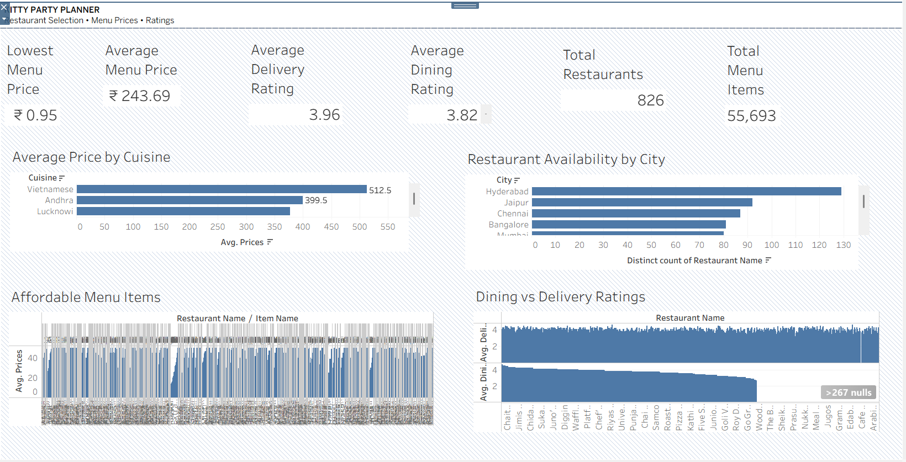

# Kitty Party Guests and Budget Analysis

A Tableau-based data analytics project that explores restaurant ratings, cuisine pricing, restaurant availability, and affordable menu options to support kitty-party planning and food-budget estimation.

## Project Overview

Planning a kitty party involves selecting suitable restaurants, comparing food options, and estimating costs while staying within a planned budget. This project analyzes restaurant and menu data to help users compare available options and make informed, budget-conscious food selections.

The analysis uses a cleaned Zomato dataset and presents insights through a Tableau executive dashboard and analytical visualizations.

## Business Objectives

- Compare average menu prices across cuisines.
- Identify cities with more restaurant options.
- Find affordable menu items priced at ₹50 or less.
- Compare dining ratings and delivery ratings.
- Support restaurant selection and food-budget estimation.
- Provide data-supported insights and practical recommendations.

## Tools and Technologies

- **Tableau Desktop:** Data visualization, calculated fields, KPIs, and dashboard development.
- **Microsoft Excel / CSV:** Dataset inspection and data handling.
- **Zomato Dataset:** Restaurant, cuisine, rating, location, menu-item, and price information.

## Dataset

**File:** `zomato_dataset_cleaned.csv`

The dataset contains information related to restaurant names, dining ratings, delivery ratings, cuisines, cities, menu items, prices, and votes.

### Rating Data Validation

| Metric | Result |
|---|---:|
| Rows containing both dining and delivery ratings | 74,511 |
| Unique restaurants with both ratings | 557 |

These figures were validated using Python and pandas. Multiple rows can belong to the same restaurant because the dataset includes menu-item-level records.

## Key Analytical Visualizations

### 1. Average Price by Cuisine
**Business question:** Which cuisines have higher or lower average menu prices?

Compares average listed prices across cuisines to help planners shortlist options based on their food budget.

### 2. Restaurants by City
**Business question:** Which cities have the greatest number of restaurant options?

Compares distinct restaurant counts across cities to help users explore restaurant availability in their event location.

### 3. Affordable Menu Items
**Business question:** Which menu items are listed at ₹50 or less?

Identifies lower-priced menu options that may help control food costs. Portion sizes, quantities, and suitability should be considered before finalizing selections.

### 4. Dining vs. Delivery Ratings
**Business question:** How do dining and delivery ratings compare across restaurants?

Compares both rating measures for restaurants where both ratings are available, supporting more informed restaurant selection.

## Key Performance Indicators (KPIs)

The executive dashboard includes relevant KPIs for exploring restaurant options, ratings, and menu pricing.

The validated restaurant-rating metrics are:

- **Restaurants with Both Ratings:** 557
- **Rows with Both Ratings:** 74,511

Other KPI values should be interpreted according to their definitions and the underlying dataset calculations.

## Business Insights and Recommendations

The project translates analytical findings into practical recommendations:

- Compare cuisine-level average prices before shortlisting menu options.
- Explore restaurant availability in the city where the event will take place.
- Evaluate affordable menu items while considering portion suitability and guest requirements.
- Use dining ratings when evaluating dine-in options and delivery ratings when planning delivered food.
- Estimate food costs using selected menu prices, planned quantities, and the expected number of guests.
- Validate recommendations against the relevant visualizations and supporting calculations.

Detailed recommendation justifications are available in [`Recommendation_Justification.docx`](Recommendation_Justification.docx).

## Dashboard Preview

## Project Files

| File | Description |
|---|---|
| `KPGBA1.twb` | Tableau workbook |
| `zomato_dataset_cleaned.csv` | Cleaned dataset |
| `Kitty_Party_Executive_Dashboard.png` | Executive dashboard screenshot |
| `KPI_Calculations.docx` | KPI calculation documentation |
| `Recommendation_Justification.docx` | Justifications for business recommendations |
| `.gitignore` | Git files and folders exclusion rules |

## How to Use the Project

1. Clone or download this repository.
2. Open `KPGBA1.twb` using Tableau Desktop.
3. If Tableau reports a missing data source, reconnect the workbook to `zomato_dataset_cleaned.csv`.
4. Review the executive dashboard and analytical visualizations.
5. Explore restaurant ratings, cuisine prices, city-level restaurant availability, and affordable menu items.
6. Use the findings to support food selection and estimated budget planning.

## Limitations

- Menu prices represent listed prices and may not reflect current prices or final order costs.
- Restaurant and menu-item records are not necessarily one-to-one.
- Ratings reflect the available dataset and do not guarantee an individual's experience.
- The dataset does not independently provide actual kitty-party attendance, venue expenses, decorations, gifts, or total event expenditure.
- Food-budget estimates require a separately specified guest count, menu selection, and order quantities.

Therefore, this project supports restaurant selection and food-budget estimation rather than verification of actual kitty-party expenditure.

## Future Enhancements

- Add guest-count and food-quantity planning.
- Develop a customizable food-budget calculator.
- Include separate event-expense categories such as Food and Drinks, Venue, Decorations, Games, and Gifts.
- Compare estimated expenses against a user-defined budget.
- Incorporate updated menu prices when reliable data becomes available.

## Author

**Yash Srivastava**

GitHub: [@yashjsri-hue](https://github.com/yashjsri-hue)

## Repository

[Kitty Party Guests and Budget Analysis](https://github.com/yashjsri-hue/kitty-party-guests-and-budget-analysis)

---

*This project demonstrates data preparation, KPI calculation, Tableau dashboard development, business-question-driven analysis, and evidence-based recommendation writing.*